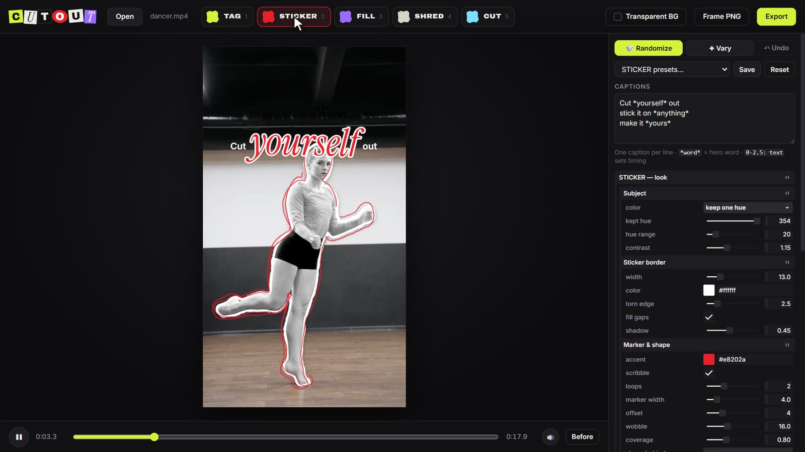
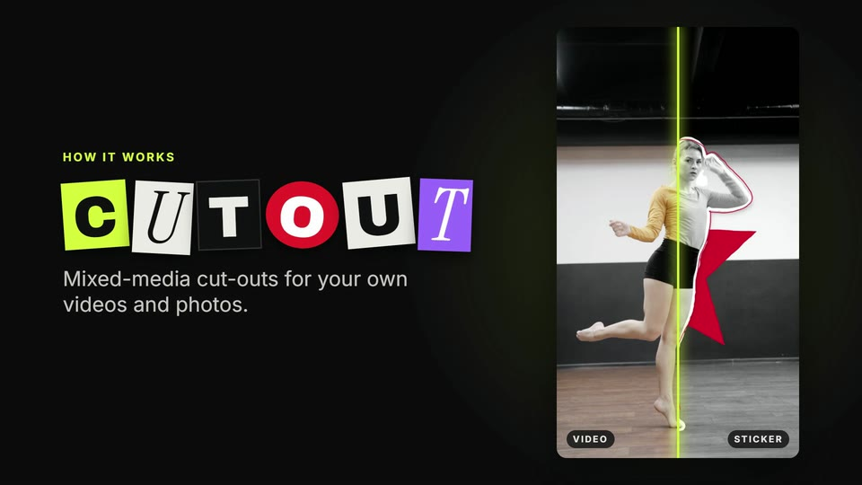
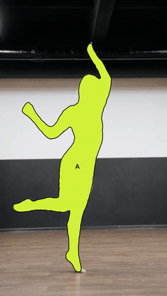
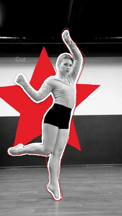
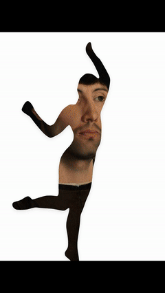
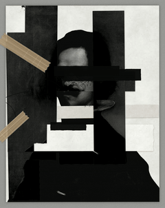
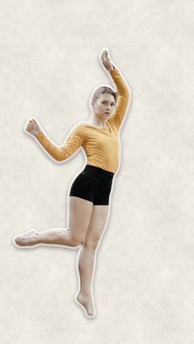
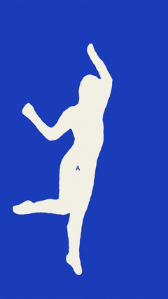

# CUTOUT

A mixed-media cut-out studio for your videos and photos. It finds the people (or the main subject) in every frame
and turns them into flat-colour figures with a boiling outline, black-and-white stickers with marker scribbles,
silhouettes filled with other pictures, torn paper portraits, or a clean background removal. Then it renders an
MP4, a transparent ProRes or WebM, or a PNG sequence. A desktop app built with Electron and TypeScript.

**Everything runs on your computer. No account, no API key, nothing is uploaded.**

The TAG look is inspired by the work of typowow and the SHRED look by the work of Yossip. CUTOUT is an independent
project and shares no code with them.



<!-- videos:start -->
## See it in action

<p align="center"><a href="docs/videos/tutorial.mp4"></a><br><b>▶ <a href="docs/videos/tutorial.mp4">How it works</a></b> (0:58, with captions)</p>

**Made with CUTOUT, from a free Pexels clip and public-domain paintings (The Met)**

<table><tr>
<td width="33%" align="center"><a href="docs/videos/examples/dancer-tag.mp4"></a><br><a href="docs/videos/examples/dancer-tag.mp4">TAG · Neon lime</a></td>
<td width="33%" align="center"><a href="docs/videos/examples/dancer-sticker.mp4"></a><br><a href="docs/videos/examples/dancer-sticker.mp4">STICKER · Red star</a></td>
<td width="33%" align="center"><a href="docs/videos/examples/dancer-fill.mp4"></a><br><a href="docs/videos/examples/dancer-fill.mp4">FILL · Met portraits</a></td>
</tr><tr>
<td width="33%" align="center"><a href="docs/videos/examples/portrait-shred.mp4"></a><br><a href="docs/videos/examples/portrait-shred.mp4">SHRED · Charcoal (photo)</a></td>
<td width="33%" align="center"><a href="docs/videos/examples/dancer-cut-paper.mp4"></a><br><a href="docs/videos/examples/dancer-cut-paper.mp4">CUT · Paper cut</a></td>
<td width="33%" align="center"><a href="docs/videos/examples/dancer-blueprint.mp4"></a><br><a href="docs/videos/examples/dancer-blueprint.mp4">TAG · Blueprint</a></td>
</tr></table>

Click any picture to play the video. Example sources: "A Woman Dancing Gracefully" by [Pavel Danilyuk](https://www.pexels.com/video/a-woman-dancing-gracefully-6939968/) (Pexels licence), and public-domain paintings from The Met (CC0): *Portrait of a Man* by [Velázquez](https://www.metmuseum.org/art/collection/search/437874) (SHRED), *Portrait of a Young Man* by [Antonello da Messina](https://www.metmuseum.org/art/collection/search/435581) (in the tutorial), and, inside FILL, portraits by [Biagio d'Antonio](https://www.metmuseum.org/art/collection/search/435664), [Jacometto](https://www.metmuseum.org/art/collection/search/436769), [Cosmè Tura](https://www.metmuseum.org/art/collection/search/437851), [Giovanni di Francesco](https://www.metmuseum.org/art/collection/search/437859), [the Master of the Castello Nativity](https://www.metmuseum.org/art/collection/search/437000), [Corneille de Lyon](https://www.metmuseum.org/art/collection/search/435951), [Sébastien Bourdon](https://www.metmuseum.org/art/collection/search/435757) and [Hugo van der Goes](https://www.metmuseum.org/art/collection/search/436521).
<!-- videos:end -->

## Install

You need:
- Windows 10 or 11 (it is built and tested on Windows 11)
- [Node.js](https://nodejs.org) 22 or newer

In the app's folder:

```
npm install
npm start
```

`npm install` also fetches Electron and an ffmpeg build (through `ffmpeg-static`), so you don't need ffmpeg on your
PATH. `npm start` builds the app and opens it. Other commands:

```
npm run dev         # start the app with live reload
npm run build       # build into out\ only
npm run build:win   # build dist\win-unpacked\CUTOUT.exe
npm run typecheck   # check the TypeScript
npm run icon        # redraw build\icon.ico and icon.png (needs Python and Pillow)
```

### The HQ matte (optional)

The cut-outs come from Google's MediaPipe models, which ship with the app and run live in the window. For the
cleanest edges (hair, objects, still photos) there is also an **HQ matte**: a Python tool that cuts out every
frame of the open file with [transparent-background](https://github.com/plemeri/transparent-background)
(InSPyReNet). It is best with an NVIDIA graphics card.

1. Install [Python](https://www.python.org/downloads/) 3.11 or newer.
2. Install PyTorch from [pytorch.org](https://pytorch.org/get-started/locally/) (the CUDA build), then:
   ```
   python -m pip install -r requirements.txt
   ```
3. If `python` on your PATH is not the Python you just set up, set the `CUTOUT_PYTHON` environment variable to its
   `python.exe`.

- The first HQ matte downloads the InSPyReNet checkpoint (about 370 MB) into `%USERPROFILE%\.transparent-background`.
- **People only** also uses a YOLO segmentation model. Set `CUTOUT_YOLO_WEIGHTS` to a YOLO segmentation `.pt` file,
  or to a folder that holds one. If you use ComfyUI, its `models\ultralytics\segm` folder works
  (`person_yolov8m-seg.pt` is picked first). If it is not set, Ultralytics downloads `yolo11m-seg.pt` (about 45 MB)
  once into `%APPDATA%\CUTOUT\models`.

Without this setup the app works as usual with the live mask. When you ask for an HQ matte, a message says what is
missing (for example "HQ matte is not set up: Python was not found"), and the app stops starting it on its own until
you restart it.

## How to use it

1. **Open** a video (MP4, MOV, WebM, M4V, MKV) or a photo (PNG, JPG, WebP, BMP, GIF, AVIF), or drop it on the
   window.
2. Pick a look with the tabs at the top (or keys **1** to **5**):
   - **TAG**: people as flat-colour cut-outs with a boiling ink outline and A B C / 1 2 3 labels. Shape (simplify,
     smooth, round or sharp corners, jitter, step at the boil rate, max people), fill colour or a palette (riso,
     neon, pastel, mono), print offset, stroke, labels and their font, and the background (original, black and
     white, blur, paper, solid colour, dim). Presets: Neon lime, Sky, Sage, Riso crowd, Blueprint, Poly shards.
   - **STICKER**: the subject in black and white, in full colour, or keeping one hue (red by default), with a white
     sticker border, a torn edge and a shadow, marker scribble loops, a shape behind (star, burst, circle, blob) and
     kinetic captions. Presets: Red market, Red star, Text behind, Zine, Clean sticker.
   - **FILL**: a silhouette filled with a new picture on every beat. The silhouette is the subject, or shape images
     you choose (a PNG with transparency is best; other pictures are cut out by the HQ matte when it is set up,
     or else their plain border colour is keyed out). The pictures come from a folder you choose (images and
     videos) or, by default, from frames across your own clip. Letterbox bars, edge line and shadow. Presets:
     Gallery white, Paper print, Window, Ink outline.
   - **SHRED**: a black-and-white portrait re-assembled from offset strips around the face (or the subject, or the
     centre), with black bars, tape, ink splats, charcoal, scribbles and white scratches on a paper sheet. **Time
     slip** mixes in strips from other moments of the clip. Presets: Charcoal, Tape heavy, Glitch strips, Quiet.
   - **CUT**: background removal. A soft edge (hair, motion) or a hard one, edge softness, shrink / grow, feather,
     main subject only; the subject in colour or black and white, an outline and a drop shadow; and the background
     replaced with nothing (transparent), a solid colour, the blurred, black-and-white or dimmed original, or paper.
     Presets: Transparent, Sticker (white edge), Green screen, Studio blur, Paper cut, Spotlight, Mono on black. For
     a photo, CUT runs the HQ matte by itself when it is set up.
3. Shape the look:
   - **Randomize** (**R**) rolls a fresh look, **Vary** (**V**) changes the current one a little, **Undo**
     (**Ctrl+Z**) goes back.
   - The presets menu holds the built-in looks and your own: **Save** keeps the current settings under a name,
     **Reset** goes back to the defaults of this look.
   - In STICKER, the **Captions** box takes one caption per line. `*word*` makes the hero word, and `0-2.5: text`
     sets when a line shows. Lines without times share the time that is left.
   - **Time & frame**: boil fps (how often the random parts change), stop-motion fps (0 is off), seed, the frame
     (source, 9:16 vertical, 4:5, 1:1, 16:9), fill or fit, zoom, grain and paper texture.
   - **Cut-out mask**: the mask from the live MediaPipe model (selfie, or multiclass for whole bodies) or from the
     HQ matte, which engine the HQ matte uses (any subject, or people only), **Make HQ matte**, threshold, temporal
     smoothing, edge soften, the smallest shape kept, and the preview quality.
   - **Transparent BG** (**T**) leaves the background see-through in every look; the preview then shows a
     checkerboard.
4. Look at it: **Space** plays and pauses, **←/→** step one frame, the bar scrubs, and holding **B** (or the
   **Before** button) shows the original.
5. Export:
   - **Frame PNG** saves the current frame, with its transparency, 1920 px on the long side. A photo in its own
     frame shape keeps its size, up to 4096 px.
   - **Export** (**Ctrl+E**) renders every frame: MP4 (H.264), MOV (ProRes 4444 with alpha), WebM (VP9 with alpha)
     or a PNG sequence with alpha (a folder of numbered frames). Long side 1280 to 3840 px, the source frame rate or
     24, 25, 30 or 60 fps, and an optional length. A photo becomes a clip of up to 5 s. The video's sound is kept
     (except in a PNG sequence).
   - A Save dialog asks where each file goes. When an export is done, Explorer opens on it.

Other keys: **Ctrl+O** opens a file.

## What's where
- `src/main/index.ts`: the Electron main process. The window, file dialogs, reading the frame rate and sound from
  ffmpeg, the export (the window sends raw frames, ffmpeg encodes them with the source's sound), the HQ matte runner
  and its cache, and the automation hooks (see Tests).
- `src/preload/index.ts`: what the window may ask of the main process (`window.api`).
- `src/renderer/index.html`, `src/renderer/src/style.css`: the window.
- `src/renderer/src/main.ts`: the controls, saved settings, presets, randomize and undo, the preview loop and the
  export loop.
- `src/renderer/src/source.ts`: opening videos and photos, exact seeking, frames from across the clip, the HQ matte
  track, the fill pictures and the shape images.
- `src/renderer/src/vision/`: MediaPipe in a web worker: the person mask (selfie or multiclass) and faces
  (BlazeFace), on the GPU with a CPU fallback.
- `src/renderer/src/core/`: the pipeline (mask, then tracked shapes with stable ids, then the look, then paper and
  grain), mask tools (smoothing, outlines, ring geometry), procedural paper, grain, torn edges, tape, ink and
  charcoal, and seeded randomness, so the preview and the export match.
- `src/renderer/src/styles/`: the five looks and the captions.
- `src/renderer/src/assets/models/`: the three MediaPipe models, with their source, checksums and licence.
- `tools/hq_matte.py`: the HQ matte. It reports progress to the app, and exits with code 4 and a "NOT SET UP" line
  when a package or the YOLO weights are missing.
- `build/`: the icon (`icon.ico`, `icon.png`) and `make-icon.py`, which draws it.
- Your data: `%APPDATA%\CUTOUT\` holds the settings and your presets, `mattes\` (one HQ matte per file and engine,
  reused when you open the same file again) and `models\` (the downloaded YOLO weights, if any).

## Tests

There are no automated tests. To check a build, the app can be driven with environment variables: it opens a file,
sets a look, renders and quits. For example, in a Command Prompt:

```
npm run build
set CUTOUT_USER_DATA=%TEMP%\cutout-check
set CUTOUT_LOAD=C:\path\to\clip.mp4
set CUTOUT_STYLE=tag
set CUTOUT_EXPORT=%TEMP%\cutout-check.mp4
set CUTOUT_EXPORT_SECONDS=2
set CUTOUT_DEBUG=1
node_modules\electron\dist\electron.exe .
```

| Variable | What it does |
|---|---|
| `CUTOUT_USER_DATA` | Use this folder for settings and mattes, starting from the default settings |
| `CUTOUT_LOAD` | Open this video or photo |
| `CUTOUT_STYLE`, `CUTOUT_PRESET` | Pick a look (`tag`, `sticker`, `fill`, `shred`, `cut`) and one of its presets by name |
| `CUTOUT_PARAMS` | JSON with settings, for example `{"style":{"labels":"123"},"global":{"hqEngine":"people"}}` |
| `CUTOUT_RANDOM` | Randomize this many times |
| `CUTOUT_TIME`, `CUTOUT_PLAY` | Go to this time (s); play for this many seconds |
| `CUTOUT_FILL_DIR`, `CUTOUT_SHAPES` | FILL's picture folder; shape images, separated by `\|` |
| `CUTOUT_HQ` | Make the HQ matte (`saliency` or `people`) after opening |
| `CUTOUT_SHOT` | Save a PNG of the window to this path, then quit (`CUTOUT_SHOT_TIMEOUT`: the latest moment, in ms) |
| `CUTOUT_EXPORT` | Export to this path, then quit |
| `CUTOUT_EXPORT_SECONDS`, `CUTOUT_EXPORT_CODEC`, `CUTOUT_EXPORT_TRANSPARENT` | Length, format (`h264`, `prores4444`, `webm`, `png`) and `1` for a transparent background |
| `CUTOUT_DEBUG` | Print the window's console to the terminal |

## Credits
- Inspiration: the TAG look follows the work of typowow, and the SHRED look the work of Yossip.
- [MediaPipe](https://ai.google.dev/edge/mediapipe/solutions/guide) by Google (Apache 2.0): `@mediapipe/tasks-vision`
  and the BlazeFace, selfie and selfie multiclass models in `src/renderer/src/assets/models` (see the `README.md`
  and `LICENSE` there).
- [Tweakpane](https://tweakpane.github.io/docs/) (MIT) for the side panel, [d3-contour](https://github.com/d3/d3-contour)
  (ISC) and [simplify-js](https://github.com/mourner/simplify-js) (BSD-2-Clause).
- The fonts [Inter](https://rsms.me/inter/), [Archivo Black](https://fonts.google.com/specimen/Archivo+Black) and
  [Instrument Serif](https://fonts.google.com/specimen/Instrument+Serif) (all SIL Open Font License 1.1), through
  [Fontsource](https://fontsource.org).
- [ffmpeg](https://ffmpeg.org/), through [ffmpeg-static](https://github.com/eugeneware/ffmpeg-static) (its ffmpeg
  build is GPL-3.0-or-later). [Electron](https://www.electronjs.org/) and
  [electron-vite](https://electron-vite.org/).
- For the optional HQ matte, installed by you and not part of this repository:
  [transparent-background](https://github.com/plemeri/transparent-background) (MIT) with InSPyReNet,
  [Ultralytics YOLO](https://github.com/ultralytics/ultralytics) (AGPL-3.0), [PyTorch](https://pytorch.org/) and
  [OpenCV](https://opencv.org/).
- The vision worker and the exact video seeking are shared with Glitch Chain, another app by the same author.
- Examples and tutorial video in `docs/`: made with CUTOUT from "A Woman Dancing Gracefully" by
  [Pavel Danilyuk](https://www.pexels.com/video/a-woman-dancing-gracefully-6939968/) (Pexels licence), and
  public-domain paintings from The Met (CC0): *Portrait of a Man* by
  [Velázquez](https://www.metmuseum.org/art/collection/search/437874) (SHRED), *Portrait of a Young Man* by
  [Antonello da Messina](https://www.metmuseum.org/art/collection/search/435581) (in the tutorial), and, inside FILL,
  portraits by [Biagio d'Antonio](https://www.metmuseum.org/art/collection/search/435664),
  [Jacometto](https://www.metmuseum.org/art/collection/search/436769),
  [Cosmè Tura](https://www.metmuseum.org/art/collection/search/437851),
  [Giovanni di Francesco](https://www.metmuseum.org/art/collection/search/437859),
  [the Master of the Castello Nativity](https://www.metmuseum.org/art/collection/search/437000),
  [Corneille de Lyon](https://www.metmuseum.org/art/collection/search/435951),
  [Sébastien Bourdon](https://www.metmuseum.org/art/collection/search/435757) and
  [Hugo van der Goes](https://www.metmuseum.org/art/collection/search/436521).

## Licence

CUTOUT's own code is MIT, see [LICENSE](LICENSE). The MediaPipe models keep their own licence (Apache 2.0).
